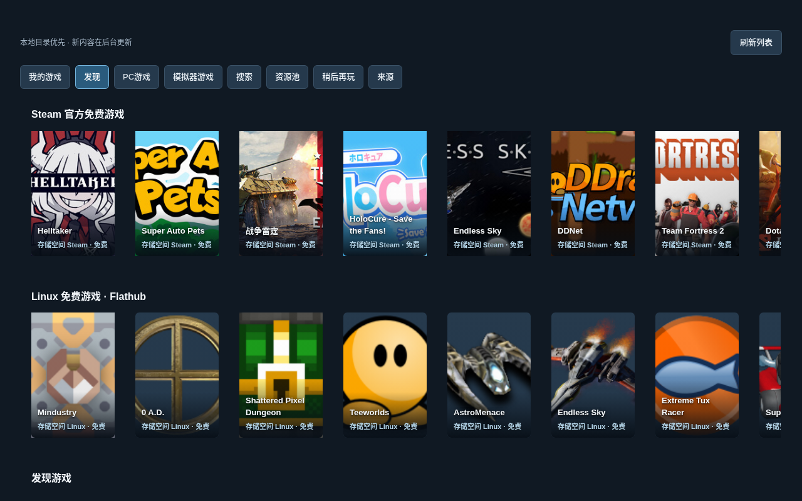
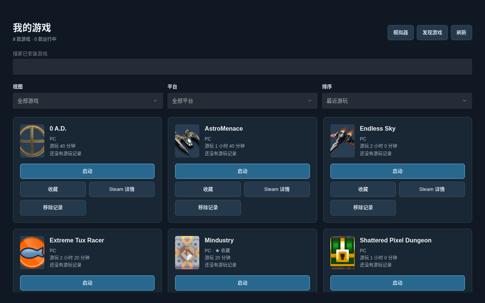
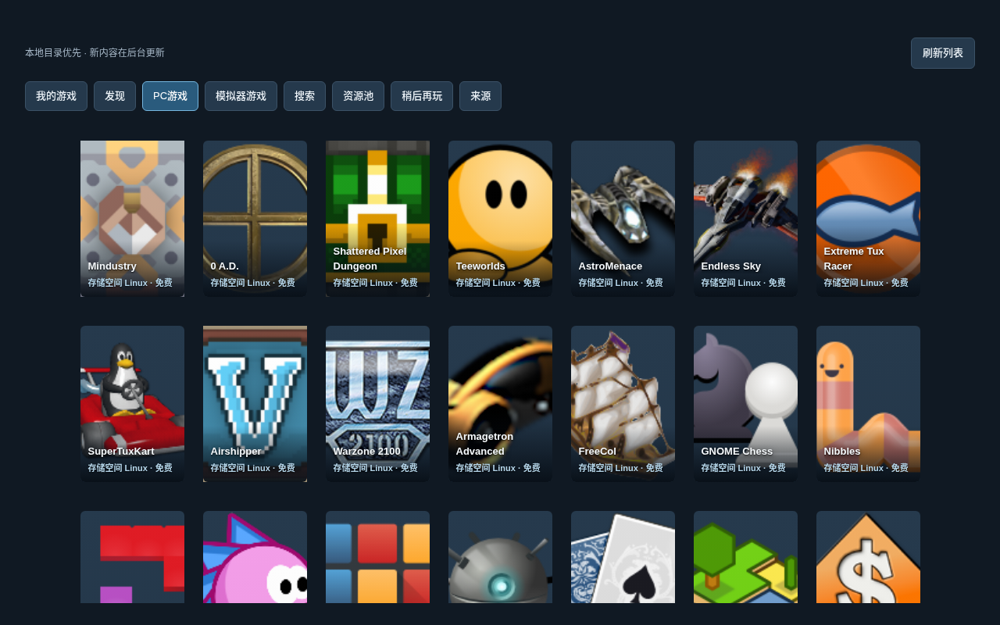
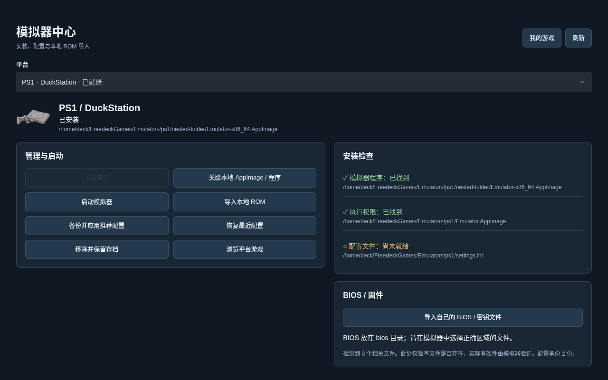
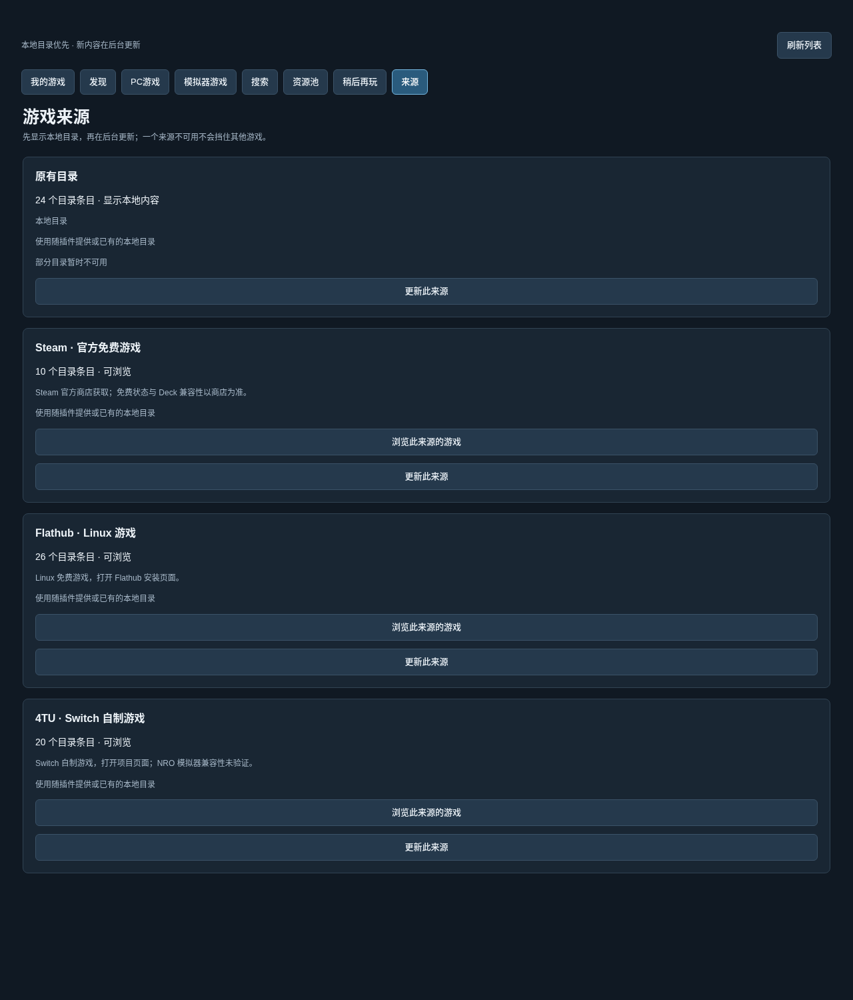

# DeckHarbor · 掌机港

**在 SteamOS 中管理游戏库、发现游戏与配置模拟器的 Decky 插件。**

基于 **NewFreedeck v0.3** 升级开发，当前版本 **0.4.6**。这是独立的二次开发版本，不是原项目、Valve 或 Decky 的官方发行版。



> 图片由实际插件 React 组件和 Steam 原生控件渲染，使用公开游戏元数据与演示状态。不是私人游戏库截图，也不代表其中的游戏已安装或通过兼容性测试。[查看全部界面与截图说明](docs/screenshots/README.md)。

## 功能

| 页面 | 功能 |
| --- | --- |
| 我的游戏 | 搜索、平台筛选、收藏、最近游玩、启动、Steam 详情；区分移除记录与卸载文件 |
| 发现 / PC 游戏 | 本地缓存优先、后台更新、分页浏览与游戏详情 |
| 模拟器游戏 | 按平台浏览，修复 Switch 的 ns / switch 别名匹配 |
| 来源 | Steam、Flathub、4TU 与原有目录的状态、独立更新和按来源浏览 |
| 模拟器中心 | 关联本地模拟器、导入 ROM、检查程序、配置与备份管理 |
| 稍后再玩 | 保存游戏条目及来源与获取方式 |
| 下载与设置 | 原有下载流程、队列、路径设置与云存档相关选项 |

新增公开来源共 **56 个条目**：10 个 Steam 官方免费游戏入口、26 个 Flathub Linux 游戏、20 个 Switch 自制游戏。跨来源可能重复。新增条目打开上游页面获取，不会自动下载安装或导入 Steam。

## 开始使用

运行环境：SteamOS、Steam 客户端、[Decky Loader](https://github.com/SteamDeckHomebrew/decky-loader)。当前开发目标是 Steam Deck 的 x86_64 Linux 环境。

1. 使用针对 Steam Deck 构建的插件 ZIP。GitHub 的 **Source code ZIP 不是可直接安装的插件包**。
2. 在 Decky 开发者设置中选择从 ZIP 安装，具体入口随 Decky 版本变化。
3. 打开 DeckHarbor，进入“我的游戏”“发现游戏”或“模拟器中心”。

从 NewFreedeck 升级：先结束下载并卸载旧插件，再安装 DeckHarbor。保留 `~/.local/share/NewFreedeck` 和游戏目录，新版继续读取已有设置、记录及缓存。不要同时启用两个版本。

完整说明：[安装与升级](docs/INSTALL.md) · [使用指南](docs/USAGE.md) · [常见问题](docs/FAQ.md)

## 界面预览

| 我的游戏 | PC 游戏 |
| --- | --- |
|  |  |

| 模拟器中心 | 游戏来源 |
| --- | --- |
|  |  |

更多：[Switch 自制游戏、详情、设置与侧栏](docs/screenshots/README.md)。

## 当前边界

- 原有目录依赖上游服务，本次核对存在超时；缓存可浏览不等于旧下载链接可用。
- 4TU 条目为 Switch 自制游戏，多数面向 NRO / hbmenu，模拟器兼容性未验证。项目不提供商业 ROM、BIOS 或固件。
- 价格、地区可用性、Proton 与 Deck 兼容性以游戏实际情况为准。
- 云服务需要自己的账号；公开源码不含 SteamGridDB API Key 或百度应用凭据。
- 自动化界面检查不能替代游戏模式下的视觉检查和实体手柄实测。

## 开发与验证

```sh
npm ci
npm run typecheck
npm test
npm run build
python3 -m pip install -r requirements-dev.txt
python3 -m unittest discover -s tests -v
```

下载、解压和可选 Rust 核心需另外准备运行依赖。仓库不提交本机预编译二进制、用户数据或账号缓存。[构建与架构](docs/DEVELOPMENT.md) 说明完整打包方式；[验证记录](docs/VALIDATION.md) 区分已验证和待实测内容。

## 项目与贡献

- [变更记录](CHANGELOG.md)
- [贡献指南](CONTRIBUTING.md)
- [安全问题与隐私](SECURITY.md)
- [游戏来源](docs/catalog-sources.md)
- [来源与许可状态](LICENSE.md) · [第三方说明](THIRD_PARTY_NOTICES.md)

原始输入为 `NewFreedeck.v.0.3.zip`。该包未附项目总许可证，因此本仓库不对继承代码擅自重新许可；第三方组件按原许可证保留。公开可见不等于已获得任意再分发许可，详见许可说明。
