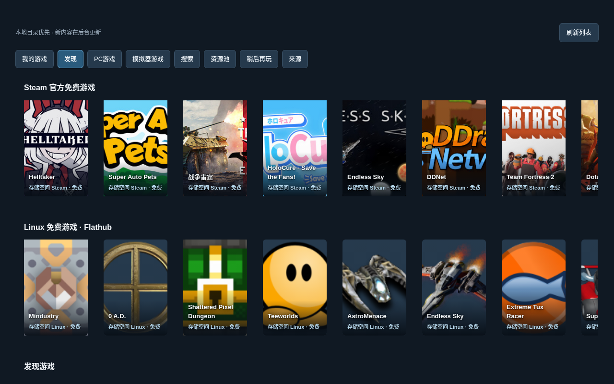
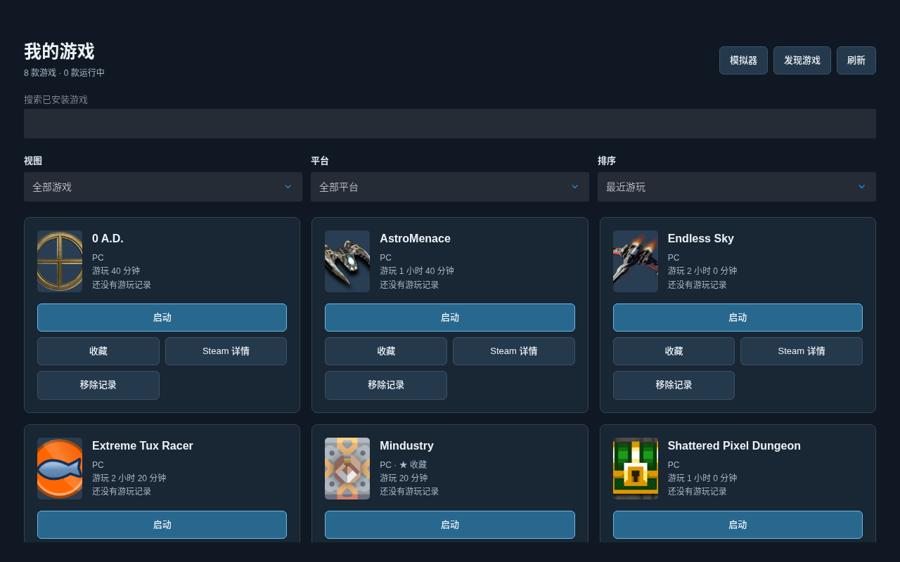
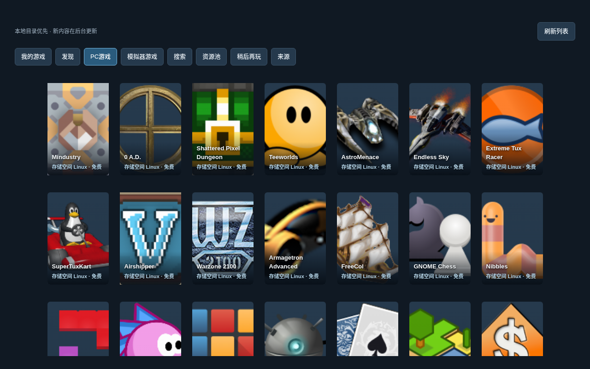
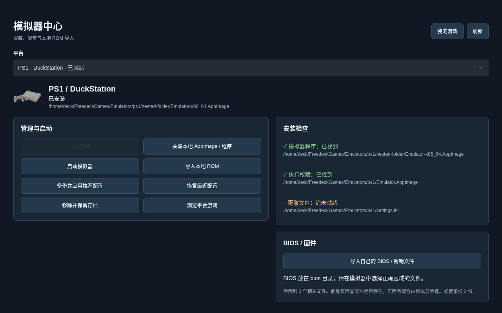
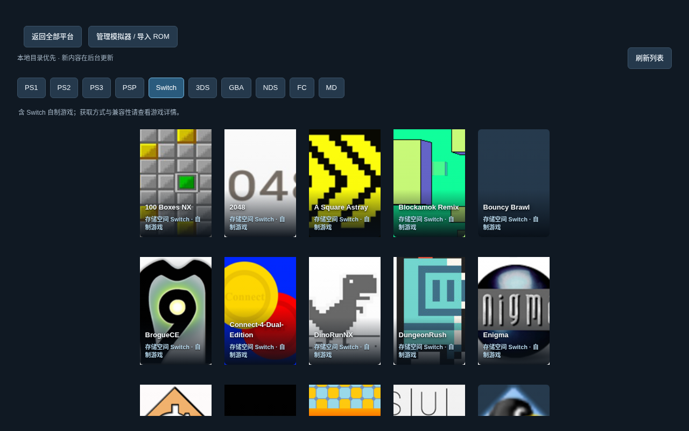
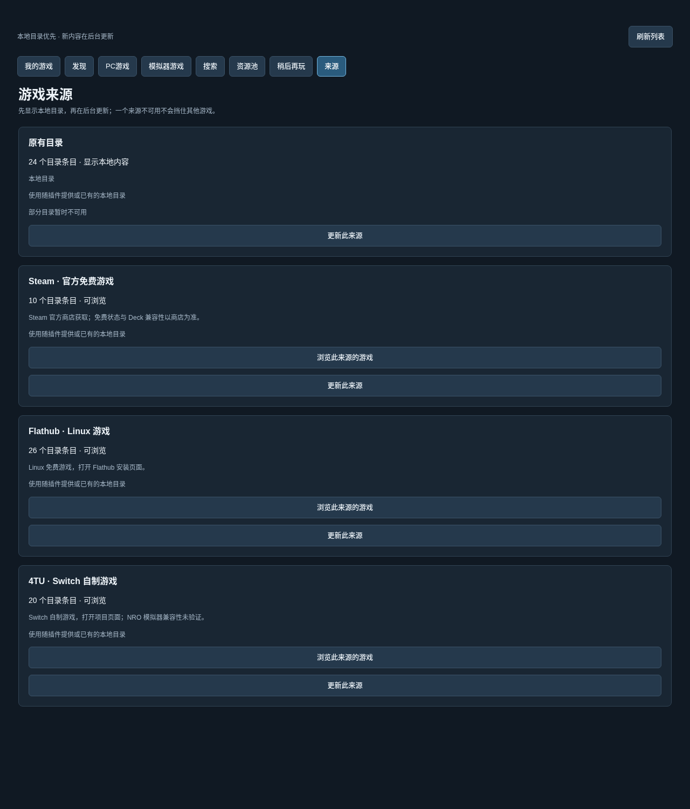
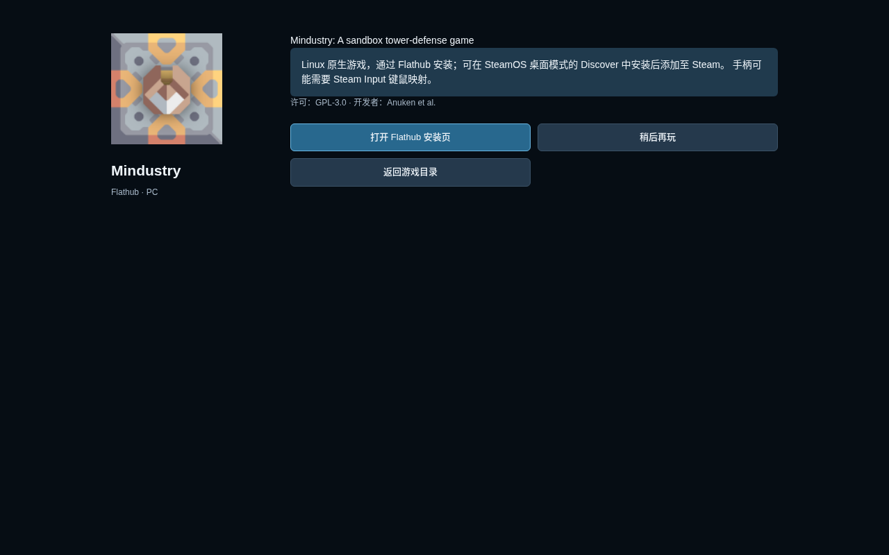
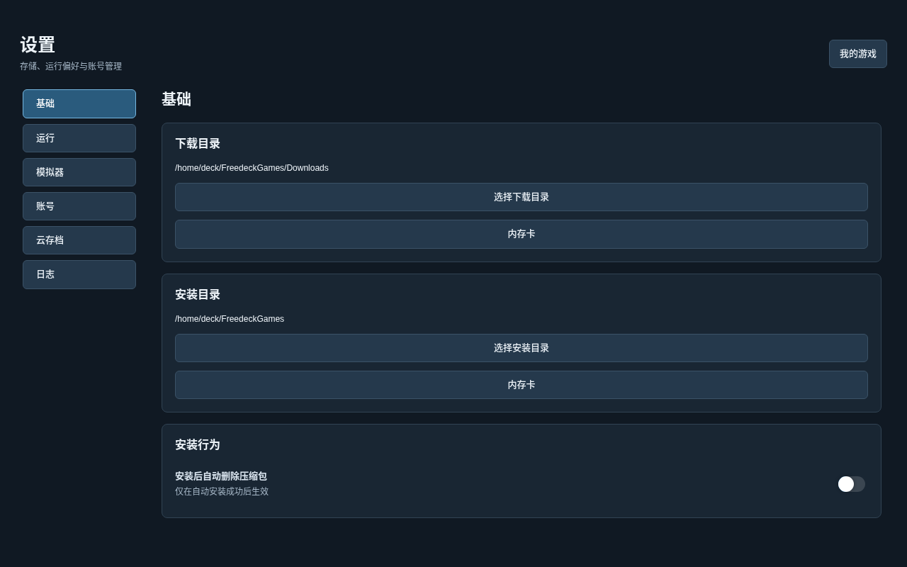
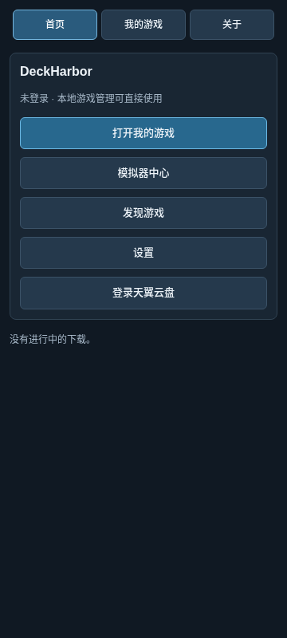
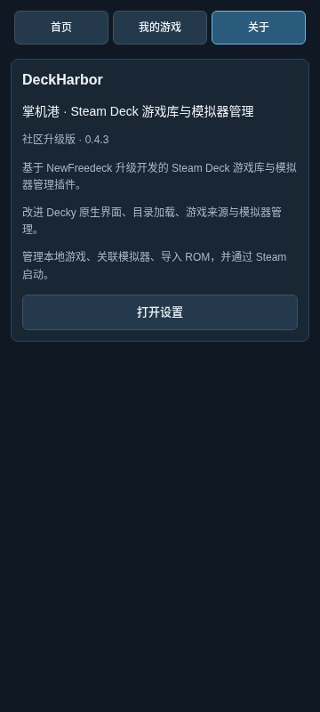

# 界面截图

日期：2026-11-17。版本：DeckHarbor 0.4.3。

这些图片使用项目实际 React 页面、Steam 原生控件及其样式生成 DOM，再在隔离 Chrome 中重绘为 PNG。后端、登录、导航、安装记录与模拟器状态使用演示数据，游戏元数据来自随包公开来源。它们不是 Steam 游戏模式实拍，不是运行兼容性证明，也不包含真实用户账号和私人游戏库。

常规页面为 1280×800，来源页为 1280×1500 以显示更多内容，侧栏为 360×800。长页面只显示当前可见部分，游戏封面由上游提供；加载失败时保留组件自身占位状态。图标适配与预览细节见 tools/ui-review/README.md。

## 发现

## 我的游戏

游玩时间、安装状态为演示数据。

## PC 游戏

## 模拟器中心

模拟器安装、配置和备份状态为演示数据。

## Switch 自制游戏

显示公开自制游戏目录，不表示已验证模拟器兼容性。

## 游戏来源

## 游戏详情与获取方式

## 设置

## Decky 侧栏与关于

| 侧栏 | 关于 |
| --- | --- |
|  |  |

## 复现

载入 tools/ui-review/build-preview.cjs --docs 生成的隔离预览，然后用 export-docs.mjs 导出 HTML，在独立浏览器配置中按对应尺寸截图。不要提交导出的整个 Steam 样式 HTML、个人浏览器配置或真实后端数据。
